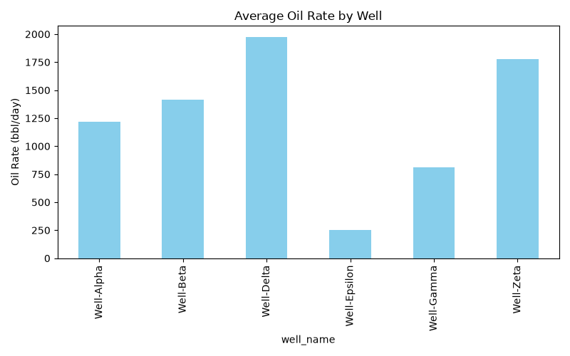
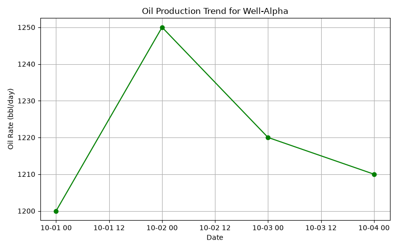
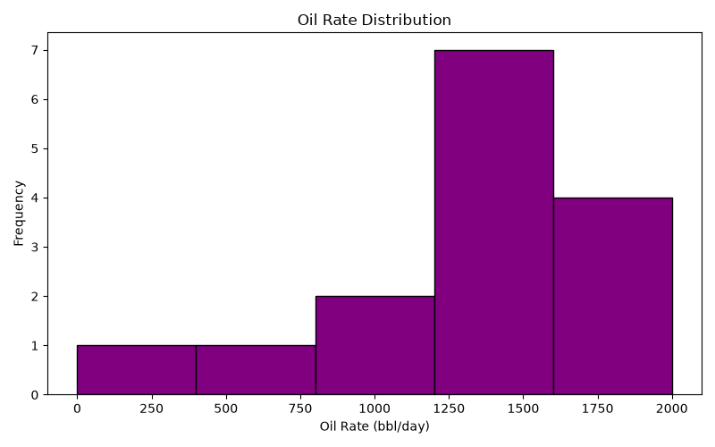
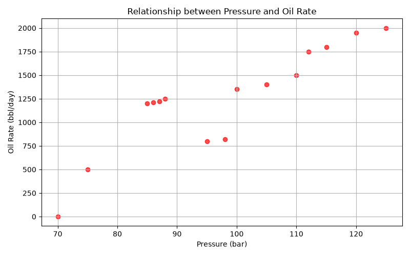
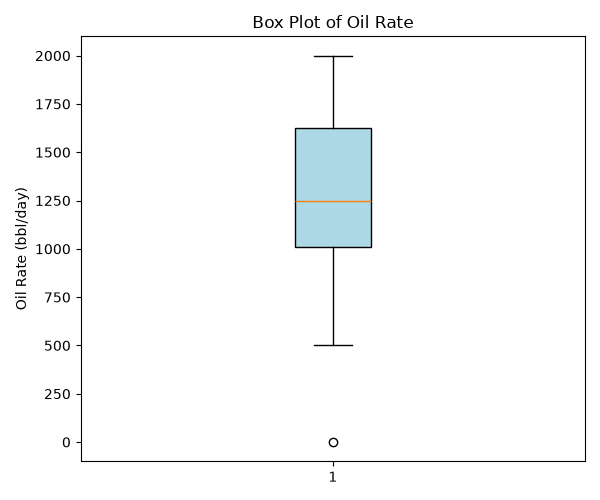

# Oil Field Data Analysis (SQL + Python)

A comprehensive data analysis project for the petroleum industry, demonstrating the integration of SQL databases with Python for data processing, analysis, and visualization.

## 🚀 Features
- Database Management: Designed a relational SQLite database (oil_field_project.db) with project_wells and project_production tables.
- Data Processing: Used Pandas to merge datasets, handle missing values, and calculate statistical summaries.
- Data Visualization: Created 5 distinct analytical plots using Matplotlib to extract actionable insights from the oil field data.

## 📈 Statistical Insights
- Mean Oil Rate: 1250.00 bbl/day
- Median Oil Rate: 1250.00 bbl/day
- Standard Deviation: 548.86 bbl/day
- Hypothesis Test (North vs South): P-value of 0.8150 (No significant difference between fields)

## 📊 Generated Visualizations

### 1. Average Oil Rate per Well
Identifies the top-performing wells (e.g., Well-Delta) and underperforming assets.

### 2. Production Trend for Well-Alpha
Time-series analysis showing the daily production fluctuations.

### 3. Distribution of Oil Rate
Histogram showing the frequency of production rates across all records.

### 4. Relationship between Pressure and Oil Rate
Scatter plot demonstrating the strong positive correlation between pressure and production.

### 5. Box Plot of Oil Rate
Box plot identifying the median production and detecting outliers (e.g., wells under maintenance).

## ⚙️ How to Run
1. Clone this repository.
2. Ensure you have Python installed.
3. Install the required libraries:
   `bash
   pip install pandas matplotlib